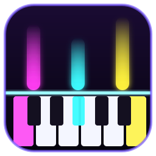

<p align="center"></p>

# Neon Keys

Plug a USB MIDI keyboard into your computer and play: every note lights up the screen, rising off
the keys over late-90s style music visualizers. Neon Keys also teaches: notes fall toward the keys
in step-by-step lessons and songs, with karaoke lyrics. It runs entirely on your computer.

## What it does

- **Light-up play:** the keys you press glow, notes rise off them like a reversed rhythm game, and
  the background is a rotating set of visualizers: MilkDrop-style swirl, plasma, warp starfield and
  Winamp-style spectrum bars. The chord you're playing is shown by name.
- **Sounds built in:** overdrive lead guitar, clean guitar, electric piano, analog synth, organ,
  8-bit chip, choir, robot voice, and some silly ones (meow cat, duck quack, fart-o-phone). Or switch
  to *Keyboard only* and let your keyboard make the sound.
- **Lessons:** notes fall down to the keys and reach them right when it's time to play. *Wait* mode
  pauses until you play the right key; *Play-along* keeps time and scores you. 18 lessons: finding
  middle C, the white keys, octaves, sharps and flats, first chords, and public-domain songs (Mary
  Had a Little Lamb, Twinkle Twinkle, Frere Jacques, Ode to Joy, Jingle Bells, Fur Elise...) with
  sing-along lyrics.
- **Add your own songs:** paste a guitar tab, piano tab, chord sheet or letter notes from the web, open
  a MIDI file, or play the tune on your keyboard and Neon Keys records it. Add lyrics and it becomes
  a lesson like the built-in ones.
- **Camera Jam:** wave your hands in front of the webcam to play notes, or hold up colorful things
  and a scan line plays them like a music box.
- **No keyboard? No problem:** play with the mouse, a touchscreen, or your computer keyboard.

## Install

Neon Keys runs inside Microsoft Edge or Google Chrome (or another Chromium browser), which can talk
to MIDI keyboards. Downloads are on the [Releases](../../releases) page.

**Windows 10/11:** download `neon-keys-<version>-windows.zip`, unzip it, and double-click
`Install Neon Keys.cmd`. That adds Neon Keys to the Start menu and desktop (no admin rights needed);
uninstall it from *Settings > Apps*. To try it without installing, double-click `Neon Keys.cmd`.
Edge comes with Windows, so there's nothing else to install.

**Ubuntu / Debian:** download `neon-keys_<version>_all.deb` and open it to install, or run
`sudo apt install ./neon-keys_<version>_all.deb`. It needs Google Chrome or Chromium.

**Other Linux:** download `neon-keys-<version>-linux.tar.gz`, extract it, and run
`./linux/install.sh` (just for you) or `./linux/install.sh --system` (everyone on the computer). On
Debian-based systems the installer offers to install Google Chrome if no browser is found.

The first time Neon Keys opens, click **Allow** when it asks to use MIDI devices (and the camera, if
you try Camera Jam).

## Keyboards

Any class-compliant USB MIDI keyboard should work; most keyboards with a USB port are. Neon Keys
tries to work out how many keys yours has from its name; if the screen doesn't match, press **Keys**
and pick 25, 32, 37, 49, 61, 76 or 88. It follows your keyboard's octave buttons, and lessons are
moved to fit smaller keyboards.

It was developed with a Donner DEK-610 (61 keys). Notes sent back to the keyboard (in *Keyboard
only* mode) need a keyboard that plays incoming MIDI, which most with built-in speakers do.

## Privacy

Everything stays on your computer. Neon Keys is served from your own machine (`localhost`) and
never connects to the internet; camera frames are analyzed in the browser and never saved or sent
anywhere. Lesson progress and your songs are stored in Neon Keys' own browser profile.

## Running from source

The app is plain HTML and JavaScript with no build step. Serve the `web` folder from localhost
(browsers only allow MIDI and audio worklets on `localhost` or HTTPS) and open it in Chrome or Edge:

```sh
cd web && python3 -m http.server 8024 --bind 127.0.0.1
# then open http://localhost:8024/
```

Or run the launchers straight from the repository: `linux/neon-keys` or `windows/Neon Keys.cmd`.

| Path | What's there |
|---|---|
| `web/` | the app: `app.js` (visuals, input), `audio.js` + `pluck-worklet.js` (sounds), `tutor.js` + `lessons.js` (lessons), `songs.js` + `song-import.js` (your songs), `camera.js` |
| `linux/`, `windows/` | launchers and installers |
| `scripts/build-release.sh` | builds the release downloads into `dist/` |

**Adding a lesson:** lessons are plain data in `web/lessons.js`; the notation is described at the top
of that file. Built-in songs must be in the public domain.

**Making a release:** update `VERSION`, then push a tag such as `v1.0.1`. A GitHub Action builds the
downloads and attaches them to a new release. To build them yourself: `scripts/build-release.sh`.

## License

MIT. See [LICENSE](LICENSE).
